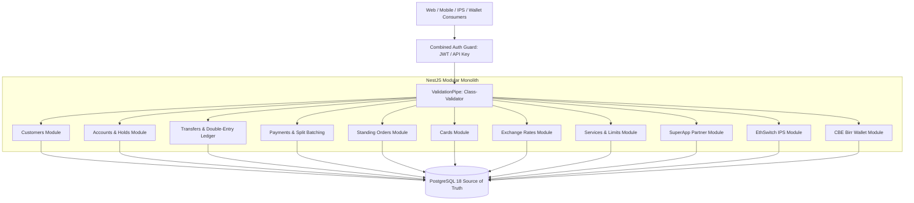

# CBE CoreIO Enterprise Banking REST API

A completely standalone, high-performance **NestJS + TypeScript (strict mode) + PostgreSQL** enterprise banking REST API reverse-engineered from the legacy Golang **CoreIO** banking integration.

The application operates **100% independently** without dependencies on Go CoreIO, Temenos T24, XML/SOAP gateways, or static XML fixtures. All banking features are backed by a normalized PostgreSQL relational database with immutable double-entry ledger bookkeeping, pessimistic concurrency row locking, and decimal-safe monetary arithmetic.

---

## 🏛️ System Architecture



---

## 🌟 Key Banking Domain Highlights

1. **Authoritative Double-Entry Ledger:**
   - Every financial transaction produces balanced, immutable `LedgerEntry` debit and credit records.
   - Balances cannot be directly modified by API consumers.
2. **Pessimistic Concurrency & Deadlock Prevention:**
   - Balances are updated within database transactions using `SELECT ... FOR UPDATE`.
   - Account IDs are sorted deterministically before lock acquisition to prevent database deadlocks.
3. **Decimal-Safe Financial Arithmetic:**
   - Monetary values stored as `NUMERIC(18, 4)`.
   - Arithmetic calculated using `BigNumber.js` via `FinancialMath` utility (zero IEEE-754 binary floating-point inaccuracy).
4. **Account Holds (`ACLOCKEDEVENTS`):**
   - Active holds dynamically lock available balance:
     $$\text{available\_balance} = \text{ledger\_balance} - \text{locked\_balance}$$
   - Supports hold placement, release, and settlement (`transferFromHold`).
5. **Idempotency Guarantees:**
   - Guaranteed deduplication via unique constraints on `idempotency_key` with automatic safe idempotent replay.
6. **OpenAPI / Swagger Documentation:**
   - Fully interactive API documentation and testing UI available at `/docs/swagger`.

---

## 🚀 Quick Start & Local Execution

### Prerequisites
- Node.js 20+
- Docker & Docker Compose (or local PostgreSQL 16+)

### 1. Configure Environment
```bash
cp .env.example .env
```

Ensure `.env` matches your local PostgreSQL instance:
```env
DB_HOST=localhost
DB_PORT=5432
DB_USERNAME=postgres
DB_PASSWORD=postgres
DB_DATABASE=cbe_banking
```

### 2. Install Dependencies
```bash
npm install
```

### 3. Seed Database with Realistic Banking Data
Populates branches, currencies, exchange rates, account categories, customers, accounts, holds, standing orders, and opening double-entry ledger entries:
```bash
npm run seed
```

### 4. Start Application
```bash
# Development mode with hot-reload
npm run start:dev

# Or production build & start
npm run build
npm run start:prod
```

The server will start on `http://localhost:3000`.

### 5. Access Interactive Swagger Documentation
Open in your browser:
```
http://localhost:3000/docs/swagger
```

---

## 🐳 Running with Docker Compose

Run the entire stack (PostgreSQL + NestJS API) in isolated containers:
```bash
docker compose up -d --build
```
API is accessible at `http://localhost:3000`.

---

## 🧪 Automated Testing Suite

The test suite validates financial math precision, banking rules, live PostgreSQL integration, and concurrent transaction safety:

```bash
# Seed test database
DB_DATABASE=cbe_banking_test npm run seed

# Run all 31 tests in sequential order
npm test -- --runInBand
```

### Test Coverage Highlights:
- **Unit Tests:** `test/unit/financial-math.spec.ts` & `test/unit/accounts-rules.spec.ts` (BigNumber precision, division by zero guard, double-entry equality).
- **Integration Tests:** `test/integration/banking-api.spec.ts` (Auth, Customers, Accounts, Holds, Transfers, Payments, IPS, Wallet).
- **Concurrency & Deadlock Tests:** `test/integration/concurrency.spec.ts` (Simultaneous debit transfers, race-condition prevention, concurrent idempotency collisions).

---

## 📚 Complete Project Documentation

Detailed design specifications are located in the [`docs/`](file:///Users/jeo/Development/eagle/cbe/coreio/banking-rest-api/docs) directory:
- [CoreIO Analysis](file:///Users/jeo/Development/eagle/cbe/coreio/banking-rest-api/docs/coreio-analysis.md)
- [API Inventory (55 Operations)](file:///Users/jeo/Development/eagle/cbe/coreio/banking-rest-api/docs/api-inventory.md)
- [Architecture & Design](file:///Users/jeo/Development/eagle/cbe/coreio/banking-rest-api/docs/architecture.md)
- [Database Schema & ERD](file:///Users/jeo/Development/eagle/cbe/coreio/banking-rest-api/docs/database-schema.md)
- [Business Rules & Invariants](file:///Users/jeo/Development/eagle/cbe/coreio/banking-rest-api/docs/business-rules.md)
- [API Contracts & Examples](file:///Users/jeo/Development/eagle/cbe/coreio/banking-rest-api/docs/api-contracts.md)
- [CoreIO Compatibility Guide](file:///Users/jeo/Development/eagle/cbe/coreio/banking-rest-api/docs/coreio-compatibility.md)
- [Testing & Verification Guide](file:///Users/jeo/Development/eagle/cbe/coreio/banking-rest-api/docs/testing.md)
- [Limitations & Operational Scope](file:///Users/jeo/Development/eagle/cbe/coreio/banking-rest-api/docs/limitations.md)
