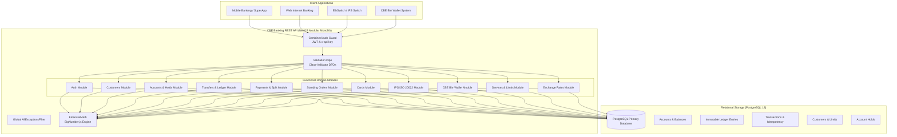

# Banking REST API Architecture & System Design

## 1. Architectural Philosophy & Overview

The **CBE Banking REST API** is an enterprise-grade banking backend engineered from first principles in **NestJS** and **TypeScript** (strict mode), using **PostgreSQL** as its authoritative financial source of truth.

It is designed to replace legacy T24/XML gateway integrations (specifically the Golang `CoreIO` reference implementation) with a decoupled, high-performance, resilient, and audit-compliant modular monolith.

### System Boundary & Independence

---

## 2. Core Architectural Pillars

### 2.1 Double-Entry Bookkeeping & Financial Invariants
- Direct updates to ledger balances without balancing journal entries are strictly forbidden.
- For every debit posting, an exact equal credit posting is executed in the `ledger_entries` table.
- Ledger entries are strictly append-only and immutable. Historical entries cannot be modified or deleted. Corrections are applied via compensating reversal transactions.

### 2.2 Concurrency & Deadlock Prevention
- Concurrency conflicts and race conditions during balance-altering transactions are resolved through PostgreSQL **pessimistic row locking** (`SELECT ... FOR UPDATE`).
- To prevent database deadlocks when two concurrent transactions transfer funds between the same pair of accounts in reverse directions:
  $$\text{Account IDs are sorted lexicographically before lock acquisition: } [A, B] \text{ where } A < B$$
- Concurrent duplicate requests submitting identical `idempotencyKey` values are serialized via unique database indexes; secondary attempts are caught and returned as clean idempotent replays without duplicate ledger mutations.

### 2.3 Decimal-Safe Monetary Arithmetic
- Floating-point representations (IEEE-754 numbers) are completely prohibited in financial arithmetic to prevent rounding anomalies.
- All monetary values are stored in PostgreSQL as `NUMERIC(18, 4)`.
- Runtime calculations utilize `FinancialMath` powered by `BigNumber.js` configured with `ROUND_HALF_UP` and strict decimal constraints.

---

## 3. Layered Module Structure

Each domain module adheres to Clean Architecture separation of concerns:

1. **HTTP Controller**: Validates contracts, manages HTTP status codes, handles authentication via `CombinedAuthGuard`, and documents OpenAPI annotations.
2. **DTO (Data Transfer Object)**: Defines explicit incoming request shapes, enforced strictly via `class-validator` and `class-transformer`.
3. **Application Service**: Coordinates transaction lifecycles, orchestrates pessimistic locks, executes domain validations, and logs audit events.
4. **Domain Invariants**: Enforces business rules (status transitions, sufficiency of available balance, limits, AML checks).
5. **Persistence Layer**: TypeORM repositories communicating with PostgreSQL over connection pools.
