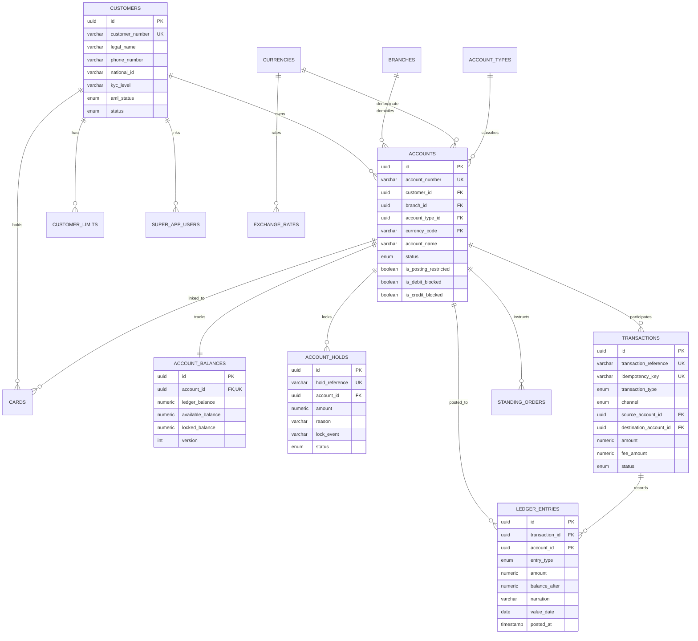

# PostgreSQL Relational Database Schema & Domain Model

## 1. Entity Relationship Diagram (ERD)

---

## 2. Table Specifications & Constraints

### 2.1 `customers`
- **Primary Key:** `id` (UUID)
- **Unique Constraints:** `customer_number`
- **Indexes:** `phone_number`, `national_id` (Fayda NID)
- **Key Columns:**
  - `customer_number`: varchar(20), bank-wide customer identifier
  - `aml_status`: enum (`CLEAR`, `SUSPECT`, `BLOCKED`)
  - `status`: enum (`ACTIVE`, `INACTIVE`, `SUSPENDED`, `DECEASED`)

### 2.2 `accounts`
- **Primary Key:** `id` (UUID)
- **Unique Constraints:** `account_number` (13-character string, e.g. `1000123456789`)
- **Foreign Keys:**
  - `customer_id` -> `customers.id` (RESTRICT)
  - `branch_id` -> `branches.id` (RESTRICT)
  - `account_type_id` -> `account_types.id` (RESTRICT)
  - `currency_code` -> `currencies.code` (RESTRICT)
- **Restrictions Flags:**
  - `is_posting_restricted`, `is_debit_blocked`, `is_credit_blocked`

### 2.3 `account_balances`
- **Primary Key:** `id` (UUID)
- **Foreign Keys:** `account_id` -> `accounts.id` (CASCADE, UNIQUE)
- **Columns:**
  - `ledger_balance`: `numeric(18, 4)`
  - `available_balance`: `numeric(18, 4)`
  - `locked_balance`: `numeric(18, 4)`
  - `version`: integer optimistic locking counter
- **Invariant:**
  $$\text{available\_balance} = \text{ledger\_balance} - \text{locked\_balance}$$

### 2.4 `account_holds` (`ACLOCKEDEVENTS` Reference)
- **Primary Key:** `id` (UUID)
- **Unique Constraints:** `hold_reference` (e.g. `HLD-001`)
- **Foreign Keys:** `account_id` -> `accounts.id` (CASCADE)
- **Columns:**
  - `amount`: `numeric(18, 4)`
  - `lock_event`: `COURT_ORDER`, `PLEDGE`, `PENDING_SETTLEMENT`
  - `status`: enum (`ACTIVE`, `RELEASED`, `SETTLED`, `EXPIRED`)

### 2.5 `transactions`
- **Primary Key:** `id` (UUID)
- **Unique Constraints:** `transaction_reference` (e.g. `FT2629399881`), `idempotency_key`
- **Columns:**
  - `transaction_type`: `INTERNAL_TRANSFER`, `IPS_TRANSFER`, `WALLET_TRANSFER`, `BILL_PAYMENT`, `SPLIT_PAYMENT`, `RTGS_TRANSFER`, `CASH_DEPOSIT`, `FEE`, `REVERSAL`
  - `channel`: `CORE`, `WEB`, `MOBILE`, `IPS`, `CBE_BIRR`, `ATM`, `POS`, `SYSTEM`
  - `amount`, `fee_amount`: `numeric(18, 4)`
  - `status`: enum (`PENDING`, `COMPLETED`, `FAILED`, `REVERSED`)

### 2.6 `ledger_entries` (Double-Entry Bookkeeping)
- **Primary Key:** `id` (UUID)
- **Foreign Keys:**
  - `transaction_id` -> `transactions.id` (CASCADE)
  - `account_id` -> `accounts.id` (RESTRICT)
- **Columns:**
  - `entry_type`: enum (`DEBIT`, `CREDIT`)
  - `amount`: `numeric(18, 4)`
  - `balance_after`: `numeric(18, 4)`
  - `narration`: varchar(255)
  - `value_date`: date
  - `posted_at`: timestamp
